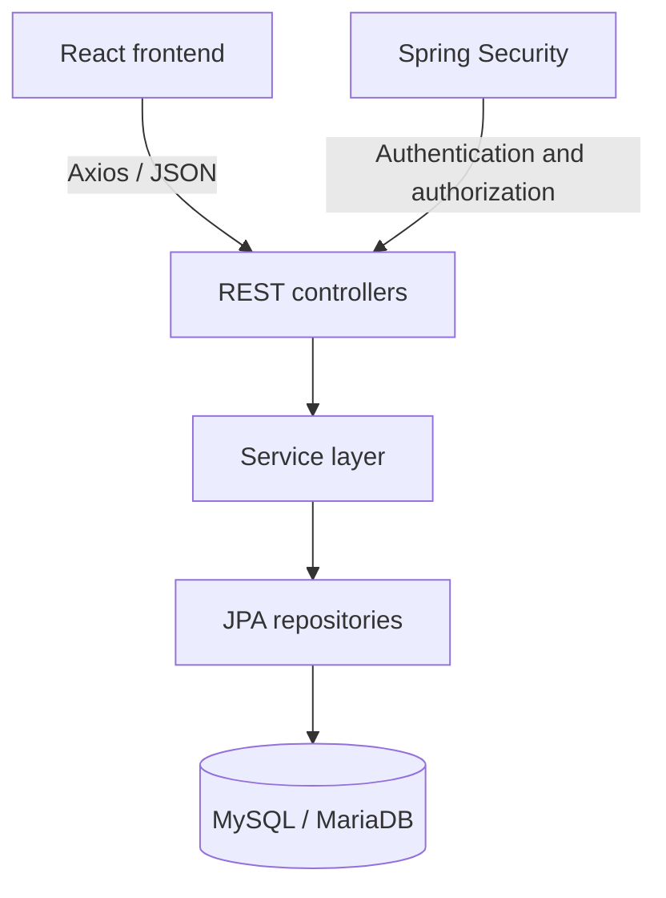
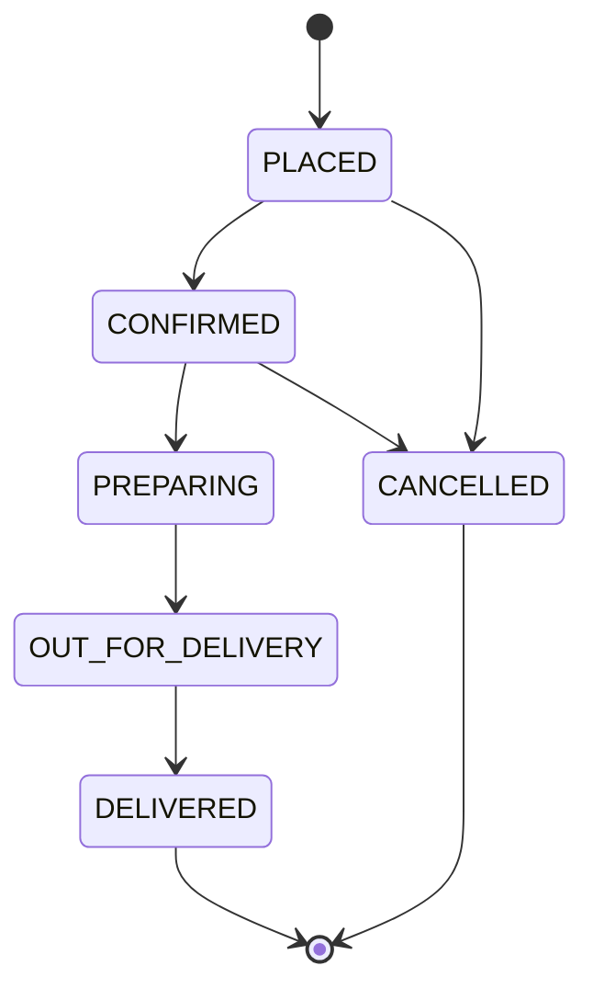

<div align="center">
🍽️ Crave
Good food. A few clicks away.
A full-stack food ordering application built with React and Spring Boot, featuring customer ordering, a kitchen dashboard, and administrator controls.


Overview · Features · Tech Stack · Setup · API
</div>
---
Overview
Crave brings a single restaurant's ordering workflow into one application. Customers discover dishes and place orders, staff manage preparation and delivery progress, and administrators maintain the menu and user access.
The frontend communicates with a layered Java backend through REST APIs. Accounts and orders are stored in a relational database, while Spring Security enforces permissions on protected endpoints.
Features
🛍️ Customer experience
Browse dishes by category and search by name or description.
Filter the menu for vegetarian options.
Add dishes to a shopping bag and adjust quantities.
Register and sign in with email and password.
Enter delivery details and kitchen notes at checkout.
Place cash-on-delivery orders.
Follow order progress with automatic refresh every 12 seconds.
Cancel an order while its status is Placed.
View order history and update profile details.
👨‍🍳 Staff dashboard
View incoming restaurant orders and customer delivery details.
Filter orders by status.
Advance orders through the preparation and delivery workflow.
Cancel placed or confirmed orders when necessary.
🛠️ Administrator dashboard
Access the restaurant order dashboard.
Create, edit, and remove menu items.
Manage prices, categories, vegetarian labels, and availability.
Assign Customer, Staff, or Admin roles to other accounts.
View active-order counts and delivered sales for the latest 200 orders.
🔐 Backend safeguards
BCrypt password hashing and signed JWT access tokens.
Server-side role and order-ownership checks.
Request validation and explicit request/response DTOs.
Prices and delivery charges calculated on the server.
Customer-scoped idempotency keys to prevent duplicate checkout requests.
Historical item names and prices preserved in order snapshots.
Optimistic locking for concurrent order updates.
Optional Google OAuth2 / OpenID Connect sign-in when configured.
Tech Stack
Layer	Technologies
Frontend	React 19, JavaScript, HTML, CSS, Bootstrap 5, Lucide icons
Frontend tooling	Vite, npm, React Router, Axios
Backend	Java 21, Spring Boot 3.5, Maven / Maven Wrapper
Security	Spring Security, JWT, BCrypt, optional Google OAuth2
Persistence	Spring Data JPA, Hibernate, Flyway
Database	MySQL; MariaDB through XAMPP with the compatibility configuration below
Testing	JUnit, Spring Boot Test, MockMvc, Vitest, React Testing Library
Development tools	VS Code or Eclipse, Postman
Application Architecture

The controller handles HTTP requests, the service applies business rules, and the repository communicates with the database. DTOs keep the public API separate from persistence entities.
Order Workflow

Customers can cancel their own newly placed orders. Staff and administrators control subsequent status changes. The backend rejects invalid transitions.
Getting Started
These instructions use VS Code and a persistent database.
1. Prerequisites
Install:
JDK 21, including the Java compiler.
Node.js 24 LTS and npm.
MySQL Server 8.x, or XAMPP's MariaDB service.
VS Code, with Microsoft's Extension Pack for Java.
Verify in a new PowerShell terminal:
```powershell
java -version
javac -version
node -v
npm.cmd -v
```
The Maven Wrapper, when included in `backend`, downloads Maven automatically. Otherwise, install Maven or use Eclipse's Maven integration for builds.
2. Get the source
Clone this repository using its Code → HTTPS URL, then open the project folder in VS Code. Open the folder containing both `backend` and `frontend`.
3. Create the database
Start your database service. With XAMPP, start MySQL in the control panel; Apache is not needed for the Java application.
Connect as a database administrator and execute:
```sql
CREATE DATABASE IF NOT EXISTS crave
CHARACTER SET utf8mb4
COLLATE utf8mb4_unicode_ci;

CREATE USER IF NOT EXISTS 'crave'@'localhost'
IDENTIFIED BY 'REPLACE_WITH_YOUR_DATABASE_PASSWORD';

GRANT ALL PRIVILEGES ON crave.*
TO 'crave'@'localhost';
```
Replace the password placeholder before executing. If this user already exists, use its existing password. Flyway creates the application tables on startup.
<details>
<summary><b>XAMPP / MariaDB timestamp compatibility</b></summary>
For the initial schema, these columns in `backend/src/main/resources/db/migration/V1__initial_schema.sql` must use explicit defaults:
```sql
created_at TIMESTAMP(6) NOT NULL DEFAULT CURRENT_TIMESTAMP(6),
updated_at TIMESTAMP(6) NOT NULL DEFAULT CURRENT_TIMESTAMP(6),
```
This avoids the `Invalid default value for 'updated_at'` error encountered with MariaDB 10.4. If an initial migration has already failed, inspect the schema and Flyway history before retrying. Do not delete tables containing data or edit a migration that has already been applied successfully; use a new migration for changes to an existing database.
</details>
4. Configure the backend
Create `backend/.env` manually with the following settings. Environment templates may be excluded from the repository.
```dotenv
DB_URL=jdbc:mysql://localhost:3306/crave?useSSL=false&allowPublicKeyRetrieval=true&serverTimezone=UTC
DB_USERNAME=crave
DB_PASSWORD=REPLACE_WITH_YOUR_DATABASE_PASSWORD
FRONTEND_URL=http://localhost:5173
SPRING_PROFILES_ACTIVE=default
JWT_SECRET=
ADMIN_EMAIL=admin@example.com
ADMIN_PASSWORD=
```
Fill `DB_PASSWORD` with the password configured for the database user.
Set `ADMIN_EMAIL` to your chosen administrator email.
Set `ADMIN_PASSWORD` to a unique password of at least 12 characters.
Generate a JWT secret using PowerShell:
```powershell
$bytes = New-Object byte[] 32
$rng = [System.Security.Cryptography.RandomNumberGenerator]::Create()
$rng.GetBytes($bytes)
$rng.Dispose()
[Convert]::ToBase64String($bytes)
```
Paste the generated value after `JWT_SECRET=`. Keep it stable across restarts.
> The `.env` file is read by the VS Code debug configuration below. Spring Boot does not automatically load this file when launched through a plain Maven command.
5. Configure VS Code
Create `.vscode/launch.json` at the project root, alongside `backend` and `frontend`:
```json
{
  "version": "0.2.0",
  "configurations": [
    {
      "type": "java",
      "name": "Crave Backend - MySQL",
      "request": "launch",
      "mainClass": "com.crave.CraveApplication",
      "cwd": "${workspaceFolder}/backend",
      "envFile": "${workspaceFolder}/backend/.env",
      "console": "integratedTerminal"
    }
  ]
}
```
Allow Java dependencies to finish loading. Select JDK 21 using Java: Configure Java Runtime in the Command Palette.
Open Run and Debug, select the Crave MySQL configuration, and press F5. Wait for:
```text
Started CraveApplication
```
Check the backend at http://localhost:8080/api/health. Expected response:
```json
{"status":"UP"}
```
6. Start the frontend
In a separate terminal, from the project root:
```powershell
cd frontend
npm.cmd ci
npm.cmd run dev -- --port 5173 --strictPort
```
Open http://localhost:5173.
7. Sign in and place an order
Sign in using the administrator credentials from `backend/.env`.
Open Dashboard → Manage menu to manage dishes.
Sign out and create a customer account through the signup page.
Add food to the bag, enter delivery details, and place an order.
Sign in as admin or staff to update its status.
To create staff access, register an account and change its role through Dashboard → User roles while signed in as admin. An administrator cannot change their own role.
The initial menu contains sample dishes that can be edited or removed. The admin initializer creates an account only when its email is unused; changing an environment variable does not reset an existing account's password.
Restarting the application
Start the database service.
Launch the backend through the saved VS Code configuration.
Run `npm.cmd run dev -- --port 5173 --strictPort` inside `frontend`.
Accounts and orders persist in the database. Stop the backend with Shift+F5 and the frontend with Ctrl+C.
Business Rules
Rule	Behavior
Currency	Indian rupees (INR)
Payment	Cash on delivery
Delivery fee	₹35 for orders below ₹499
Free delivery	Subtotal of ₹499 or more
Quantity	1–20 per dish
Checkout	Server validates availability and calculates totals
Customer cancellation	Allowed only while an order is placed
Customer history	Latest 100 orders
Restaurant dashboard	Latest 200 orders
API Overview
Method	Endpoint	Access
GET	`/api/health`	Public
GET	`/api/menu`	Public
POST	`/api/auth/register`	Public
POST	`/api/auth/login`	Public
GET / PUT	`/api/auth/me`	Signed-in user
POST	`/api/orders`	Customer
GET	`/api/orders`	Signed-in user's order history
GET	`/api/orders/{id}`	Owner, staff, or admin
POST	`/api/orders/{id}/cancel`	Owner, placed orders only
GET	`/api/staff/orders`	Staff or admin
PATCH	`/api/staff/orders/{id}/status`	Staff or admin
POST	`/api/menu`	Admin
PUT / DELETE	`/api/menu/{id}`	Admin
GET	`/api/admin/users`	Admin
PATCH	`/api/admin/users/{id}/role`	Admin
Protected requests use:
```http
Authorization: Bearer <access-token>
```
Import `postman/Crave.postman_collection.json` into Postman to explore the APIs. Update login request bodies to use accounts from your database; the collection includes sample demo credentials that are not created in the normal MySQL configuration. Cancellation and fulfilment are alternative test paths.
Project Layout
Path	Purpose
`backend/src/main/java/com/crave/controller`	REST controllers
`backend/src/main/java/com/crave/service`	Business logic
`backend/src/main/java/com/crave/repository`	Database access
`backend/src/main/java/com/crave/entity`	Persistence models
`backend/src/main/java/com/crave/dto`	Request and response objects
`backend/src/main/java/com/crave/security`	JWT and Google sign-in handling
`backend/src/main/java/com/crave/config`	Security configuration and initial data
`backend/src/main/resources/db/migration`	Versioned database schema
`frontend/src`	React pages, styling, and API client
`postman`	API request collection
`docs`	Additional project documentation
Tests and Builds
From `backend`, using the wrapper when available:
```powershell
.\mvnw.cmd test
.\mvnw.cmd package
```
With a separate Maven installation, use `mvn test` and `mvn package`. On Linux/macOS, use `./mvnw` instead of `mvnw.cmd`.
From `frontend`:
```powershell
npm.cmd test
npm.cmd run build
```
The initial implementation passed 12 backend integration tests and 6 frontend interaction tests, plus a frontend production build and a packaged-backend HTTP smoke check. Backend tests use H2 in MySQL compatibility mode; they do not replace testing against your database server. Customer ordering and administrator access were also verified during local XAMPP setup.
Optional Google Sign-In
Email/password login works without any Google configuration. To enable Google sign-in:
Create a Google OAuth web application client.
Configure the authorized redirect URI as `http://localhost:8080/login/oauth2/code/google`.
Supply `GOOGLE_CLIENT_ID` and `GOOGLE_CLIENT_SECRET` to the backend.
Change `SPRING_PROFILES_ACTIVE` to `google` and restart the backend.
Google sign-in requires your own credentials and consent configuration. Accounts created through Google receive the Customer role. Existing password accounts are not automatically linked by email. The external Google login round trip requires separate verification.
Troubleshooting
Problem	What to check
Browser shows connection refused on port 8080	Read the final backend startup error in VS Code's terminal.
VS Code asks for a Dotenv or JSON debugger	Select the Java run configuration rather than running the active settings file.
Settings from `.env` are missing	Put `.vscode` at the workspace root and `.env` inside `backend`; launch through F5.
Database access denied	Verify the database username/password and application user's privileges.
Invalid default value for `updated_at`	Check the explicit timestamp defaults in the MariaDB compatibility note above.
Port 5173 is in use	Stop the previous frontend instance and retry.
Admin password changes have no effect	The initializer does not overwrite existing account passwords.
Configuration and Repository Hygiene
Keep private configuration files out of version control:
```gitignore
.env
.env.*
**/node_modules/
**/target/
**/dist/
*.log
```
This pattern also excludes `.env.example`, matching this project's chosen setup. Share configuration names and placeholders through documentation instead. Keep real passwords, JWT secrets, and OAuth secrets outside committed files.
The local connection string disables database TLS and is intended for local development. Public deployment requires separate hosting, HTTPS, managed secrets, and appropriate database configuration. JWT access tokens expire after two hours; refresh tokens and immediate logout revocation are not implemented.
Future Improvements
The following are ideas, not implemented features:
Online payments and refunds.
Delivery partner assignment and location tracking.
Password reset and email notifications.
Multiple restaurants and inventory management.
Paginated order history and broader reporting.
---
<div align="center">
Crave · Good food, made with care.
</div>