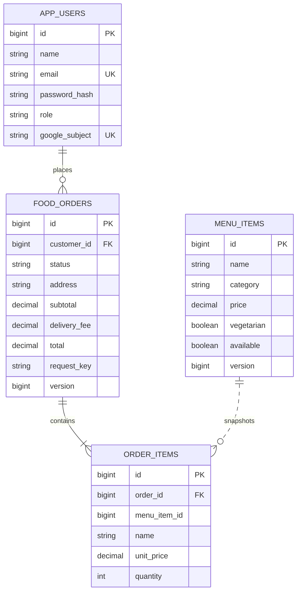
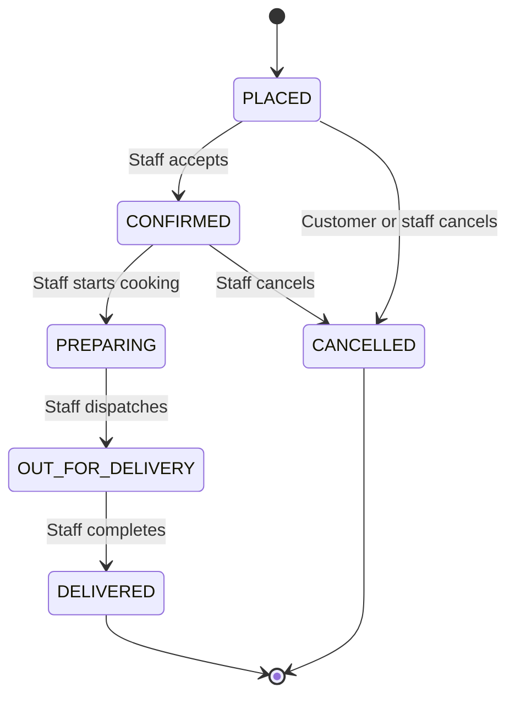

# Architecture and project explanation

Crave is a single-restaurant food ordering application. Customers order from one shared menu. Staff handle the restaurant's incoming orders. Admins control the menu and user roles.

## Request flow

React pages call Axios, which sends REST requests with JSON and a bearer token for protected actions. Spring Security validates the JWT and loads the user's current role. Controllers validate DTOs, services apply business rules, repositories use JPA/Hibernate, and MySQL stores the result.

## Roles

| Action | Public | Customer | Staff | Admin |
| --- | --- | --- | --- | --- |
| Browse menu | Yes | Yes | Yes | Yes |
| Sign up | Yes | — | — | — |
| Update own name/phone | — | Yes | Yes | Yes |
| Place an order | — | Yes | — | — |
| View own order history | — | Yes | Yes | Yes |
| Cancel own newly placed order | — | Yes | Yes | Yes |
| View restaurant orders | — | — | Yes | Yes |
| Update order status | — | — | Yes | Yes |
| Create/edit/delete menu items | — | — | — | Yes |
| Assign user roles | — | — | — | Yes |

Staff/admin own-order history can include orders placed before their role changed. The role model has no per-restaurant ownership because this is a single-restaurant project.

## Data model

The menu-to-order-item link is a logical snapshot reference rather than a foreign key. Removing a menu item preserves historical order lines. Orders store item names and unit prices at purchase time. Prices use `BigDecimal`, mapped to `DECIMAL(10,2)`, rather than floating point arithmetic on the backend.

## Order state machine

Skipping states and reopening terminal states are rejected. Optimistic locking prevents simultaneous order updates from silently overwriting each other.

## Checkout rules

- Authenticated CUSTOMER role is required.
- The request includes item IDs/quantities, address, phone and optional notes.
- Each item can occur only once, with a quantity from 1 to 20; at most 30 different lines are accepted.
- Every item must exist and be available when checkout runs.
- Backend prices determine the subtotal. Delivery costs ₹35, or zero at subtotal ₹499+.
- Client-supplied price, total, role and other unknown fields are rejected.
- The transaction stores the order and all its lines together.
- A customer-scoped `Idempotency-Key` identifies a checkout attempt. Repeating a completed request returns the original order, irrespective of a changed retry body. Start a new checkout attempt for a different order.
- A database unique constraint prevents concurrent duplicate keys from creating multiple orders. A racing request may receive HTTP 409 and can be retried using the same key to retrieve the committed order.

This project checks availability at checkout; it does not reserve stock or implement inventory counts. Kitchen status is polled by the UI, not streamed over WebSockets.

## Main REST endpoints

| Method | Path | Access |
| --- | --- | --- |
| GET | `/api/health` | Public |
| GET | `/api/menu` | Public |
| POST | `/api/auth/register` | Public |
| POST | `/api/auth/login` | Public |
| GET | `/api/auth/config` | Public |
| POST | `/api/auth/google/exchange` | Single-use Google code |
| GET / PUT | `/api/auth/me` | Signed-in user |
| POST | `/api/orders` | Customer |
| GET | `/api/orders` | Own latest 100 orders |
| GET | `/api/orders/{id}` | Owner or staff/admin |
| POST | `/api/orders/{id}/cancel` | Owner, PLACED only |
| GET | `/api/staff/orders` | Staff/admin, latest 200 orders |
| PATCH | `/api/staff/orders/{id}/status` | Staff/admin |
| POST | `/api/menu` | Admin |
| PUT / DELETE | `/api/menu/{id}` | Admin |
| GET | `/api/admin/users` | Admin |
| PATCH | `/api/admin/users/{id}/role` | Admin, except self |

Expected business errors use JSON `{ "message": "..." }`, with 400, 401, 403, 404 or 409 as appropriate. Unexpected failures return a generic HTTP 500 response and detailed server-side logs.

## Suggested demonstration for college review

1. Explain the React → REST → Controller → Service → Repository → MySQL flow.
2. Sign in as customer, filter the menu, add food and place a cash-on-delivery order.
3. Show the order in another tab signed in as staff and advance its status.
4. Return to the customer tab and show the refreshed status.
5. Sign in as admin, add a dish and change a user's role.
6. Explain server-side price validation, BCrypt, DTOs, ownership checks and order snapshots.

Use separate browser tabs: sessionStorage keeps a separate login token in each independently opened tab. Do not duplicate an already logged-in tab if you want to start with a different account.
